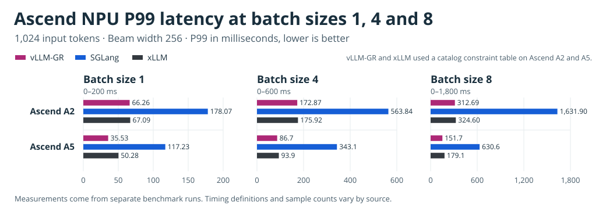
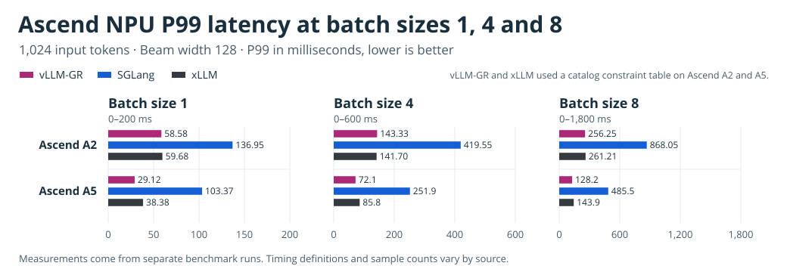

## 项目简介

今天，我们正式推出 [**vLLM-GR**](https://github.com/vllm-project/vllm-gr)。这是一个基于 vLLM 构建的开源框架，用于为生成式推荐模型提供推理和在线服务。

以视频信息流为例。根据用户的观看历史，OneRec 等模型可以生成用户接下来可能观看的视频的语义 ID（SID）。要生成供用户浏览的信息流，应用需要一组候选视频。vLLM-GR 在 vLLM 的模型执行和分页键值（KV）缓存之上加入束搜索（beam search），使引擎可以在一次请求中搜索多个候选 ID。

上图展示了推荐模型如何生成物品 ID，或对给定的候选物品打分。下文以 OneRec-1.7B 为例，沿着生成路径，从用户观看历史出发，得到 128 个候选 SID。

## 为什么需要 vLLM-GR？

推荐服务必须在单次请求的延迟预算内，把较长的交互历史转化为一组候选。每个物品 ID 可能只需要生成几个 token，但引擎需要搜索多条路径，并返回应用实际可以提供的物品。

1. **在 vLLM 技术栈上运行推荐模型。** 在昇腾 NPU 上从离线评估迁移到在线服务时，团队可以复用 vLLM 的模型执行、调度和分页 KV 缓存。
2. **降低宽束搜索的开销。** 候选路径共享已缓存的用户历史。引擎在一次请求中运行连续的束搜索步骤，并在加速器上筛选候选，从而减少重复工作以及每一步与主机的协调开销。
3. **让推荐结果与物品目录保持一致。** 目录约束引导搜索生成可映射到真实物品的 ID。框架支持更新模型和目录，因此团队可以随模型和库存变化更新推荐结果。

## 架构详解

vLLM-GR 将推荐搜索集成到 vLLM 引擎中。vLLM 提供调度器、模型执行和分页 KV 缓存。vLLM-GR 增加了一个贯穿搜索全程的束搜索会话，用于跟踪候选路径的分叉。

从接纳请求到搜索完成，每个束搜索会话都由 EngineCore 管理。调度器将预填充（prefill）和解码（decode）阶段交给 Worker 执行。每个阶段，模型执行器为下一个 token 打分，候选筛选过程记录每条保留路径的分数和父路径。下一轮解码根据这些父路径索引读取对应的 KV 状态。

### 核心特性

- **易用性。** 通过离线 Python 接口、兼容 OpenAI 的 HTTP 接口或 gRPC 提交一次完整的束搜索请求。引擎执行解码循环，在一次响应中返回候选序列及其分数。
- **灵活性。** 可以在整个词表中搜索，也可以将生成范围限制在物品目录中的语义 ID。每个阶段的束宽和每条父路径的候选上限均可单独设置，因此搜索过程中可以探索比最终返回结果更多的未完成 ID。
- **性能。** 多条候选路径共享提示词的 KV 缓存，避免为每条路径重复复制用户历史。加速器执行当前阶段时，主机同时准备下一阶段，从而减少解码步骤之间的等待时间。

*一次请求按 2 → 3 → 2 的束宽搜索，最终返回两个候选。由于目录中没有物品的 SID 以 `A1 · B1` 开头，这条分支会被过滤。全词表搜索会跳过这一步过滤。图中的 SID 和分数均为示例。*

*在预填充—解码—解码（PDD）流水线中，调度器接纳一个 `BeamSearch()` 请求，将预填充阶段交给 Worker。预填充为 SID 的第一段打分，同时主机准备第 1 轮解码。第 1 轮解码执行期间，主机准备第 2 轮解码。第二轮解码继承入选父路径的后缀 KV，生成两个完整的 SID。绿色标出各阶段选中的 SID 组件。*

## 性能评测

P99 端到端延迟包含主机 CPU 和设备的执行时间，测量结果会因具体机器而异。昇腾基准测试结果为初步数据，反映当前的优化进度。我们将继续优化 vLLM-GR 在昇腾上的性能。

基准测试通过 P99 延迟展示束宽和批大小对生成式推荐尾延迟的影响。两张总览图将输入长度固定为 1,024 个 token，在昇腾 910（A2）和昇腾 950 上比较束宽 256 与 128、批大小 1、4 和 8 的结果。图表汇总了多组独立测试，各组使用的计时口径、样本量和后端设置有所不同。

在昇腾 910（A2）和昇腾 950 上，vLLM-GR 与 xLLM 均使用了物品目录约束表。

束宽为 256 时，在两款 NPU 上，vLLM-GR 在批大小为 4 和 8 的测试中均取得图中所列后端的最低 P99。在昇腾 910（A2）上，批大小为 8 时，vLLM-GR 和 xLLM 的延迟分别为 312.69 ms 和 324.60 ms，两者均启用了目录约束。

展开下方各硬件平台的图表，可以查看更大范围内不同束宽和输入长度下的延迟变化。具体测试范围因加速器和批大小而异。

昇腾 910（A2）· B=1、B=4 和 B=8

部分曲线未延伸到最后一组配置，因为对应测试超出了设备内存容量。在输入长度为 8,192 个 token、批大小为 8 时，vLLM-GR 完成了束宽最高为 1,024 的整组测试。

昇腾 950 · B=1、B=4 和 B=8

批大小为 8 时，vLLM-GR 在束宽为 128 时的 P99 为 128.2 ms，在束宽为 256 时为 151.7 ms。在两张总览图对应的束宽下，vLLM-GR 在三个批大小的测试中均取得图中所列后端的最低 P99。

## 后续路线图

我们的目标是让框架同时支持候选生成和排序，覆盖长用户历史与宽束搜索等场景。

- **支持更多模型。** 将候选打分能力扩展到 HSTU、MTGR 和 RankMixer，为 OneTrans 增加原生服务支持，并探索如何优化总参数量更大的推荐模型的服务性能，包括混合专家（MoE）模型。
- **提高束搜索的灵活性。** 探索将候选价值纳入筛选，以及为语义 ID 增加输出头。计划在不同类型的设备上支持更深层级的 SID，并支持可变长度生成，使单条候选路径遇到结束标记（EOS）时即可停止，释放其占用的槽位和 KV 缓存，从而接纳新请求。
- **在线组批和调度。** 探索一种在线调度器，由它决定何时组批以及哪些排队请求进入批次，使用户历史长度不同的请求可以一起执行，并在过载时限制队列长度。将形状相近的批次归为一组，使它们能够重放同一张已捕获的计算图，减少填充。
- **长历史和 KV 复用。** 优化 10,000 个 token 及以上历史序列的预填充，并探索在线性注意力或稀疏注意力下执行束搜索。随着用户历史增长，在不同请求之间复用未变化前缀的 KV 块，避免对这些 token 重复执行预填充。
- **分布式推理和 KV 缓存。** 探索分布式 KV 缓存，使服务实例可以复用同节点或跨节点其他设备上的 KV 块，并评估两种情形下的模型分片和 KV 传输开销。
- **加强与上游 vLLM 的集成。** 基于 vLLM 的引擎和平台接口，将上游的调度和 KV 缓存管理改进引入推荐工作负载。定期将 vLLM-GR 更新到较新的稳定版 vLLM，并在受支持的设备上验证引擎正确性、推荐质量和服务性能。

## 快速入门

vLLM-GR 0.30.0 基于 vLLM 0.30.0，支持昇腾 NPU。

### 安装

请参照 [昇腾 NPU 安装指南](https://github.com/vllm-project/vllm-gr/blob/main/docs/getting_started/installation/npu.md) 完成安装。

### 部署生成式推荐模型

按照 [昇腾离线快速入门](https://github.com/vllm-project/vllm-gr/blob/main/docs/getting_started/quickstart.md#ascend) 运行 OneRec-1.7B。若要通过 HTTP 提供服务，请按 [OneRec 示例](https://github.com/vllm-project/vllm-gr/blob/main/examples/online_serving/beam_search/README.md#run-one-request) 操作，并指定 `--constraint-backend npu`。

## 加入社区

如果你正在将其他推荐模型接入 vLLM-GR，欢迎介绍模型如何表示交互历史，以及它预测哪些内容。如果你遇到服务性能瓶颈，请提供模型、历史长度、束宽和硬件配置，方便其他人复现。 [GitHub 仓库](https://github.com/vllm-project/vllm-gr) · [提交 Issue](https://github.com/vllm-project/vllm-gr/issues) · [贡献指南](https://github.com/vllm-project/vllm-gr/blob/main/CONTRIBUTING.md)

## 致谢

感谢 InferMatrix 团队的 Hongsheng Liu 和 Han Zhang 率先提出让 vLLM 支持高性能生成式推荐推理。感谢 Inferact 的 Roger Wang 和 Zhipeng Wang 参与深入讨论，帮助确定 vLLM-GR 的路线图和架构。

同时感谢以下团队和社区成员为 vLLM-GR 作出的贡献，以及他们分享的大规模生产部署经验和反馈。

- [Inferact](https://inferact.ai/): [Zhipeng Wang](https://github.com/princepride), [Roger Wang](https://github.com/ywang96)
- [InferMatrix Team](https://infermatrix.si/): [Han Zhang](https://github.com/zhanghanleo10), [Shucheng Zhang](https://github.com/candanzg), [Xiaodong Tian](https://github.com/parallel-star8), [Yunpeng Zhi](https://github.com/ZhiYunpenghuawei), [Yi Ding](https://github.com/DINGEde), [Jierui Yu](https://github.com/JerryTcl), [Hongsheng Liu](https://github.com/hsliuustc0106)
- openPangu: [Xinming Han](https://github.com/Lechmere-1), [Zhiwei Yi](https://github.com/zhiweiyi11), [Mengyuan Ma](https://github.com/mengyuanuom), [Yongxiang Feng](https://github.com/fxy18)
- TikTok-Global E-commerce: [Bin Wang](https://github.com/wangbin-cs), [Junhua Long](https://github.com/LJHG)
- ByteDance-Commerce & Advertising: [Haoran Ma](https://github.com/MaTwickenham), [Wenqiang Zhou](https://github.com/SENGEL-code), [Junwen Guo](https://github.com/CrazyKing5023)
- Lingquai: [Chunxu Jin](https://github.com/Trenx-J), [Wuping Liu](https://github.com/wupingL)
