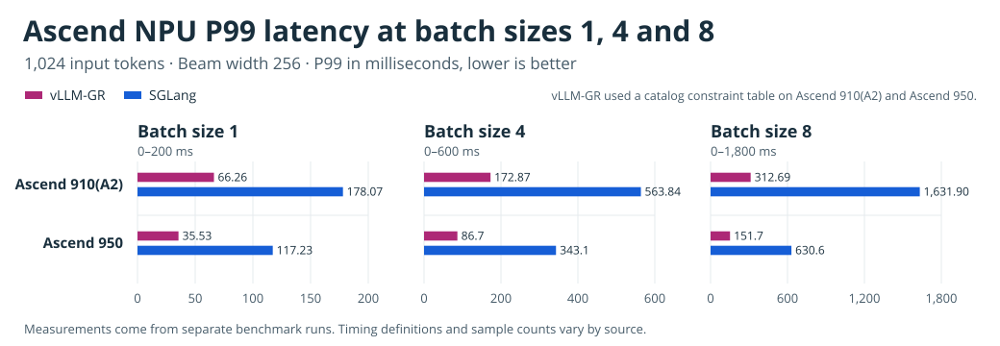
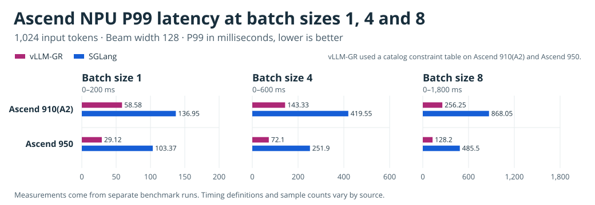

vLLM 社区正式发布 [**vLLM-GR**](https://github.com/vllm-project/vllm-gr)，并提供昇腾（Ascend）NPU 后端。vLLM-GR 0.30.0 基于 vLLM 0.30.0。开发者可以在昇腾上先跑通 OneRec-1.7B 的离线推理，再部署在线 HTTP 服务。模型前向和每轮束搜索的候选筛选在 NPU 上执行，应用提交一次请求即可拿到一组候选及其分数。

在昇腾 950 的初步评测中，输入为 1,024 个 token、批大小为 8、束宽为 128 时，vLLM-GR 的 P99 端到端延迟为 **128.2 ms**。

## 从长历史生成一组推荐候选

以视频信息流为例，OneRec 根据用户的观看历史生成视频的语义 ID（SID）。生成一个 SID 只需几个 token，但推荐服务要在单次请求的延迟预算内搜索多条候选路径，并返回物品目录中可提供的内容。

上图展示了推荐模型生成物品 ID 或为给定候选打分的两条路径。以 OneRec-1.7B 的生成路径为例，引擎可以从用户观看历史出发，在一次请求中生成 128 个候选 SID。

## 昇腾 NPU 如何加速候选生成

vLLM-GR 复用 vLLM 的模型执行、调度和分页 KV 缓存。昇腾后端基于 CANN 和 vLLM-Ascend 运行，并调用 xllm-ops 提供的昇腾算子完成注意力计算、KV 缓存处理和候选筛选。EngineCore 从接纳请求到返回结果，统一管理预填充（prefill）和各轮解码（decode）。[昇腾安装与算子说明](https://github.com/vllm-project/vllm-gr/blob/main/docs/getting_started/installation/npu.md)

### 在设备上应用目录约束并筛选候选

启用目录约束后，NPU 按约束表过滤无法映射到真实物品的候选前缀，再保留得分最高的有效路径。筛选结果直接供下一轮设备端解码使用，省去每轮把候选回传主机再决定下一步的开销。昇腾也支持全词表搜索。使用 NPU 约束表时，可以按阶段设置束宽和每条父路径的候选上限。[功能兼容性](https://github.com/vllm-project/vllm-gr/blob/main/docs/user_guide/feature_compatibility.md)

*一次请求按 2 → 3 → 2 的束宽搜索，最终返回两个候选。由于目录中没有物品的 SID 以 `A1 · B1` 开头，这条分支会被过滤。全词表搜索会跳过这一步过滤。图中的 SID 和分数均为示例。*

### 复用长历史的 KV 缓存

同一请求的候选路径共享用户历史的前缀 KV，各自维护分叉后的后缀 KV。每轮筛选记录保留路径的分数和父路径索引，下一轮据此读取对应的缓存。在满足融合解码条件时，昇腾上的 XAttention 用一个算子完成前缀和后缀的注意力计算，减少宽束搜索中的重复开销。[昇腾解码实现](https://github.com/vllm-project/vllm-gr/blob/main/docs/design/feature/npu_decode_execution.md)

### 让主机准备与 NPU 执行重叠

启用异步调度时，NPU 执行当前阶段，主机可以同时准备下一轮解码。以三段式 SID 为例，预填充和两轮解码分别确定一段 SID，引擎跑完整条流水线后统一返回结果。

*在预填充—解码—解码（PDD）流水线中，调度器接纳一个 `BeamSearch()` 请求，将预填充阶段交给 Worker。预填充为 SID 的第一段打分，同时主机准备第 1 轮解码。第 1 轮解码执行期间，主机准备第 2 轮解码。第二轮解码继承入选父路径的后缀 KV，生成两个完整的 SID。绿色标出各阶段选中的 SID 组件。*

## 性能评测

P99 端到端延迟包含主机 CPU 和设备的执行时间，测量结果会因具体机器而异。昇腾基准测试结果为初步数据，反映当前的优化进度。我们将继续优化 vLLM-GR 在昇腾上的性能。

基准测试通过 P99 延迟展示束宽和批大小对生成式推荐尾延迟的影响。两张总览图将输入长度固定为 1,024 个 token，对比 vLLM-GR 与 SGLang 在昇腾 910（A2）和昇腾 950 上的表现，覆盖束宽 256 和 128、批大小 1、4 和 8。图表汇总了多组独立测试，各组使用的计时口径、样本量和后端设置有所不同。

vLLM-GR 在两款昇腾 NPU 上均启用了物品目录约束表。

### 昇腾 910（A2）

输入为 1,024 个 token、束宽为 256 时，vLLM-GR 在批大小为 4 和 8 的测试中的 P99 均低于 SGLang，其中批大小为 8 时的 P99 为 **312.69 ms**。在长序列测试中，输入为 8,192 个 token、批大小为 8 时，vLLM-GR 完成了束宽最高为 1,024 的整组测试。

### 昇腾 950

输入为 1,024 个 token、批大小为 8 时，vLLM-GR 在束宽为 128 和 256 时的 P99 分别为 **128.2 ms** 和 **151.7 ms**。在两种束宽下，vLLM-GR 在批大小为 1、4 和 8 的测试中的 P99 均低于 SGLang。

## 快速入门

1. **准备昇腾环境。** 根据设备选择对应镜像，安装 CANN 运行环境和 vLLM-GR 所需的算子，并完成环境检查。[昇腾 NPU 安装指南](https://github.com/vllm-project/vllm-gr/blob/main/docs/getting_started/installation/npu.md)

2. **跑通离线推理。** 按快速入门运行 OneRec-1.7B，查看返回的候选序列与累计对数概率。[昇腾离线快速入门](https://github.com/vllm-project/vllm-gr/blob/main/docs/getting_started/quickstart.md#ascend)

3. **接入在线服务。** 按 OneRec HTTP 示例指定 `--constraint-backend npu`，加载物品目录约束表并验证返回的 SID。[OneRec HTTP 示例](https://github.com/vllm-project/vllm-gr/blob/main/examples/online_serving/beam_search/README.md#run-one-request)

## 后续路线图

我们的目标是让框架同时支持候选生成和排序，覆盖长用户历史与宽束搜索等场景。

- **支持更多模型。** 将候选打分能力扩展到 HSTU、MTGR 和 RankMixer，为 OneTrans 增加原生服务支持，并探索如何优化总参数量更大的推荐模型的服务性能，包括混合专家（MoE）模型。
- **提高束搜索的灵活性。** 探索将候选价值纳入筛选，以及为语义 ID 增加输出头。计划在不同类型的设备上支持更深层级的 SID，并支持可变长度生成，使单条候选路径遇到结束标记（EOS）时即可停止，释放其占用的槽位和 KV 缓存，从而接纳新请求。
- **在线组批和调度。** 探索一种在线调度器，由它决定何时组批以及哪些排队请求进入批次，使用户历史长度不同的请求可以一起执行，并在过载时限制队列长度。将形状相近的批次归为一组，使它们能够重放同一张已捕获的计算图，减少填充。
- **长历史和 KV 复用。** 优化 10,000 个 token 及以上历史序列的预填充，并探索在线性注意力或稀疏注意力下执行束搜索。随着用户历史增长，在不同请求之间复用未变化前缀的 KV 块，避免对这些 token 重复执行预填充。
- **分布式推理和 KV 缓存。** 探索分布式 KV 缓存，使服务实例可以复用同节点或跨节点其他设备上的 KV 块，并评估两种情形下的模型分片和 KV 传输开销。
- **加强与上游 vLLM 的集成。** 基于 vLLM 的引擎和平台接口，将上游的调度和 KV 缓存管理改进引入推荐工作负载。定期将 vLLM-GR 更新到较新的稳定版 vLLM，并在受支持的设备上验证引擎正确性、推荐质量和服务性能。

## 加入社区

如果你正在将其他推荐模型接入 vLLM-GR，欢迎介绍模型如何表示交互历史，以及它预测哪些内容。如果你遇到服务性能瓶颈，请提供模型、历史长度、束宽和硬件配置，方便其他人复现。 [GitHub 仓库](https://github.com/vllm-project/vllm-gr) · [提交 Issue](https://github.com/vllm-project/vllm-gr/issues) · [贡献指南](https://github.com/vllm-project/vllm-gr/blob/main/CONTRIBUTING.md)

## 致谢

感谢 InferMatrix 团队的 Hongsheng Liu 和 Han Zhang 率先提出让 vLLM 支持高性能生成式推荐推理。感谢 Inferact 的 Roger Wang 和 Zhipeng Wang 参与深入讨论，帮助确定 vLLM-GR 的路线图和架构。

同时感谢以下团队和社区成员为 vLLM-GR 作出的贡献，以及他们分享的大规模生产部署经验和反馈。

- [Inferact](https://inferact.ai/): [Zhipeng Wang](https://github.com/princepride), [Roger Wang](https://github.com/ywang96)
- [InferMatrix Team](https://infermatrix.si/): [Han Zhang](https://github.com/zhanghanleo10), [Shucheng Zhang](https://github.com/candanzg), [Xiaodong Tian](https://github.com/parallel-star8), [Yunpeng Zhi](https://github.com/ZhiYunpenghuawei), [Yi Ding](https://github.com/DINGEde), [Jierui Yu](https://github.com/JerryTcl), [Hongsheng Liu](https://github.com/hsliuustc0106)
- openPangu: [Xinming Han](https://github.com/Lechmere-1), [Zhiwei Yi](https://github.com/zhiweiyi11), [Mengyuan Ma](https://github.com/mengyuanuom), [Yongxiang Feng](https://github.com/fxy18)
- TikTok-Global E-commerce: [Bin Wang](https://github.com/wangbin-cs), [Junhua Long](https://github.com/LJHG)
- ByteDance-Commerce & Advertising: [Haoran Ma](https://github.com/MaTwickenham), [Wenqiang Zhou](https://github.com/SENGEL-code), [Junwen Guo](https://github.com/CrazyKing5023)
- Lingquai: [Chunxu Jin](https://github.com/Trenx-J), [Wuping Liu](https://github.com/wupingL)
